<a href="https://www.helloimtom.dev/"><picture><source media="(prefers-color-scheme: dark)" srcset="./assets/hero.svg" /><source media="(prefers-color-scheme: light)" srcset="./assets/hero-light.svg" /></picture></a>

Fullstack developer from France, shipping web and mobile products from the beach in Fuerteventura 🌴

<a href="https://www.helloimtom.dev/"><picture><source media="(prefers-color-scheme: dark)" srcset="./assets/btn-site.svg" /><source media="(prefers-color-scheme: light)" srcset="./assets/btn-site-light.svg" /></picture></a> <a href="https://www.linkedin.com/in/thomas-augot"><picture><source media="(prefers-color-scheme: dark)" srcset="./assets/btn-linkedin.svg" /><source media="(prefers-color-scheme: light)" srcset="./assets/btn-linkedin-light.svg" />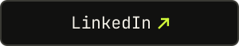</picture></a> <a href="https://medium.com/@thomasaugot"><picture><source media="(prefers-color-scheme: dark)" srcset="./assets/btn-medium.svg" /><source media="(prefers-color-scheme: light)" srcset="./assets/btn-medium-light.svg" />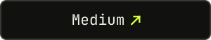</picture></a> <a href="mailto:thomas.augot@gmail.com"><picture><source media="(prefers-color-scheme: dark)" srcset="./assets/btn-email.svg" /><source media="(prefers-color-scheme: light)" srcset="./assets/btn-email-light.svg" />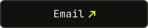</picture></a>

## Favorite stack

<picture><source media="(prefers-color-scheme: dark)" srcset="./assets/stack.svg" /><source media="(prefers-color-scheme: light)" srcset="./assets/stack-light.svg" />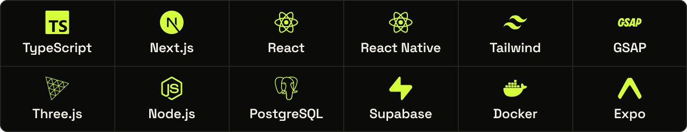</picture>

## Selected work

Mostly private repos, so here's the live work. [More on my portfolio →](https://www.helloimtom.dev/en/work)

  <a href="https://materiaprimamagazine.com/"><picture><source media="(prefers-color-scheme: dark)" srcset="./assets/work-materia-prima.svg" /><source media="(prefers-color-scheme: light)" srcset="./assets/work-materia-prima-light.svg" />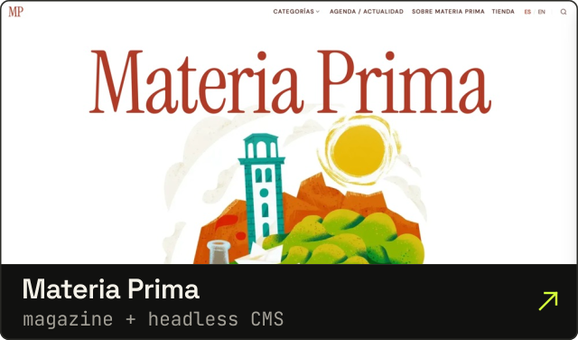</picture></a>
  <a href="https://frontonking.com"><picture><source media="(prefers-color-scheme: dark)" srcset="./assets/work-fronton-king.svg" /><source media="(prefers-color-scheme: light)" srcset="./assets/work-fronton-king-light.svg" />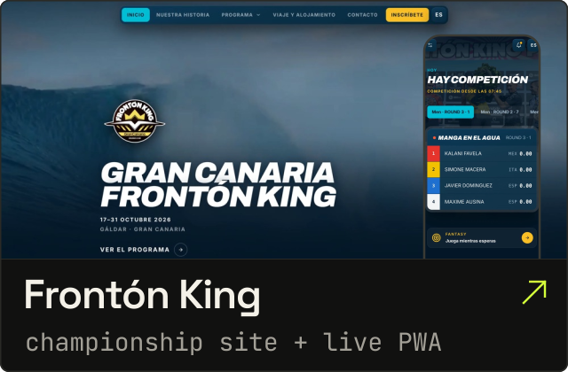</picture></a>
  <a href="https://www.dospordosgrupoimagen.com/"><picture><source media="(prefers-color-scheme: dark)" srcset="./assets/work-dosxdos-web.svg" /><source media="(prefers-color-scheme: light)" srcset="./assets/work-dosxdos-web-light.svg" />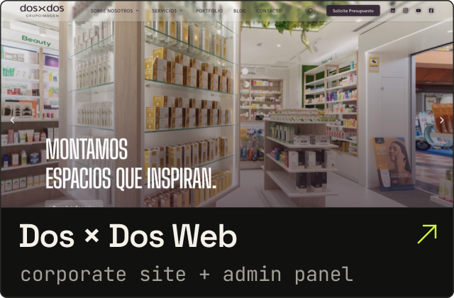</picture></a>
  <a href="https://www.helloimtom.dev/en/work/dosxdos-montadores-app"><picture><source media="(prefers-color-scheme: dark)" srcset="./assets/work-montadores.svg" /><source media="(prefers-color-scheme: light)" srcset="./assets/work-montadores-light.svg" />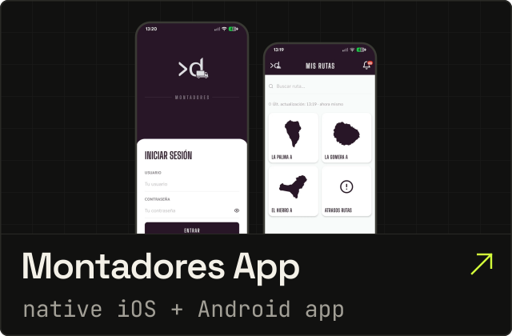</picture></a>

## On Medium

My latest articles, sharing what I build and solutions to recurring challenges.

<a href="https://medium.com/@thomasaugot/i-built-a-lead-qualifying-chatbot-in-next-js-559d7404977a"><picture><source media="(prefers-color-scheme: dark)" srcset="./assets/commit-chatbot.svg" /><source media="(prefers-color-scheme: light)" srcset="./assets/commit-chatbot-light.svg" /></picture></a>
<a href="https://medium.com/@thomasaugot/how-i-got-my-next-js-portfolio-to-score-100-on-lighthouse-accessibility-0405c3582f3a"><picture><source media="(prefers-color-scheme: dark)" srcset="./assets/commit-a11y.svg" /><source media="(prefers-color-scheme: light)" srcset="./assets/commit-a11y-light.svg" />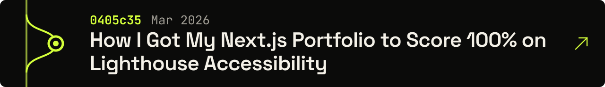</picture></a>
<a href="https://medium.com/@thomasaugot/how-to-keep-rich-animations-snappy-in-next-js-15-46d90f503b15"><picture><source media="(prefers-color-scheme: dark)" srcset="./assets/commit-animations.svg" /><source media="(prefers-color-scheme: light)" srcset="./assets/commit-animations-light.svg" /></picture></a>
<a href="https://medium.com/@thomasaugot/how-to-set-up-google-analytics-with-google-tag-manager-in-next-js-15-in-2025-dedfcaee875a"><picture><source media="(prefers-color-scheme: dark)" srcset="./assets/commit-analytics.svg" /><source media="(prefers-color-scheme: light)" srcset="./assets/commit-analytics-light.svg" />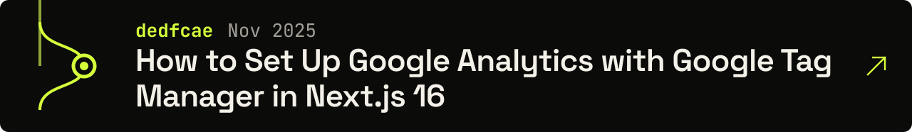</picture></a>

[All articles →](https://medium.com/@thomasaugot)
